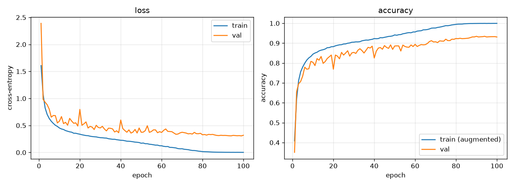

# ResNet with 5×5 convolutions: Kaggle CIFAR-10 challenge

A CIFAR-style ResNet that uses **5×5 kernels everywhere** (stem and all residual blocks), built for a
Kaggle CIFAR-10 ResNet architecture challenge. The training pipeline is a single PyTorch script that
keeps the whole dataset on the GPU and runs augmentation there too, so a 100-epoch run takes about
6.5 minutes on one A100.

**Best result so far:** 93.44% validation accuracy and **92.74% held-out test accuracy** with a
3.0M-parameter ResNet-20 (`runs/baseline_21368912`).

## Repository layout

```
train.py        model, data pipeline, training loop, Kaggle submission writer
train.sbatch    SLURM job script (NYU HPC, A100, Singularity container)
runs/<name>/    output of each run: summary.json, history.json, curves.png, submission.csv
data/           competition data (not tracked, see below)
```

## Data

Download the competition files into `data/`:

| File | Contents |
|---|---|
| `train_images/`, `train_labels.csv` | 50,000 labeled 32×32 RGB PNGs, 5,000 per class (`id,filename,label`) |
| `test_images/`, `test.csv` | 2,000 unlabeled Kaggle test PNGs (`id,filename`) |
| `sample_submission.csv` | submission format (`id,label`) |

On first run the PNGs are decoded once into `data/cache.npz`. Later runs load that cache in seconds.

The labeled set is split **per class** with a fixed seed into:

| Split | Images | Role |
|---|---|---|
| train | 40,000 | gradient updates |
| val | 5,000 | picks the best epoch (checkpointing, early stopping) |
| test | 5,000 | scored **once** at the end, as an unbiased local estimate of the Kaggle score |

## Architecture

```
input 3×32×32
└─ stem: conv5×5(3→w) · BN · ReLU
   ├─ stage 1: n × BasicBlock(w),   32×32
   ├─ stage 2: n × BasicBlock(2w),  16×16   (first block stride 2)
   └─ stage 3: n × BasicBlock(4w),   8×8    (first block stride 2)
      └─ global average pool · linear(4w → 10)
```

Each `BasicBlock` is conv5×5 · BN · ReLU · conv5×5 · BN, plus a shortcut, then ReLU. The shortcut is
the identity, or a 1×1 conv + BN projection when the stride or channel count changes. Depth is
`2·sum(blocks) + 2`.

The default config, `--blocks 3 3 3 --width 32 --kernel 5`, gives **ResNet-20 with 2,986,666
parameters**. The number of stages, blocks per stage, base width and kernel size are all flags.

## Training recipe

| | |
|---|---|
| Optimizer | SGD, Nesterov momentum 0.9, lr 0.1, batch 128 |
| Weight decay | 5e-4 on conv/linear weights only (none on BN or biases) |
| Schedule | 1 epoch of linear warmup, then cosine decay to 0 |
| Augmentation (GPU) | color jitter (brightness/contrast/saturation ±0.2), random horizontal flip, 4-px zero-pad random crop |
| Normalization | per-channel mean/std computed on the training split |
| Precision | bfloat16 autocast, channels-last memory format |
| Epochs | 100, early stopping after 20 epochs without a new best val accuracy |

The checkpoint with the best val accuracy is reloaded at the end to score the local test split and
write `submission.csv`.

## Results

| Run | Epochs | Color jitter | Best epoch | Val acc | Local test acc | Train time (A100) |
|---|---|---|---|---|---|---|
| `baseline_21361893` | 30 | off | 29 | 91.62% | 92.14% | 75 s |
| `baseline_21368912` | 100 | 0.2 / 0.2 / 0.2 | 90 | **93.44%** | **92.74%** | 390 s |

Training curves for the 100-epoch run:



Training accuracy reaches 99.97% by the end, while val loss bottoms out and then creeps back up. More
regularization or augmentation is the obvious next lever.

## Usage

```bash
# full run: 100 epochs with early stopping, writes runs/baseline/
python train.py

# quick CPU sanity check: 1 epoch on 1,000 images
python train.py --smoke

# other variants
python train.py --blocks 2 2 2 --width 16
python train.py --epochs 200 --patience 0 --jitter 0 0 0 --out runs/e200
```

On the NYU HPC cluster (run from the parent `deep_learning/` directory):

```bash
sbatch kaggle_resnet_cifar10/train.sbatch
OUT=kaggle_resnet_cifar10/runs/e200 ARGS="--epochs 200 --patience 0" sbatch --export=ALL kaggle_resnet_cifar10/train.sbatch
```

Every run writes these files to `--out`:

- `submission.csv`: Kaggle predictions (`id,label`)
- `summary.json`: config, parameter count, best epoch, val and test accuracy, predicted class counts
- `history.json`: per-epoch train/val loss and accuracy, learning rate, epoch time
- `curves.png`: loss and accuracy plots
- `best.pt`: best checkpoint, with the normalization stats and args (not tracked in git)

Requirements: Python 3.12, PyTorch, NumPy, Pillow, and matplotlib.
