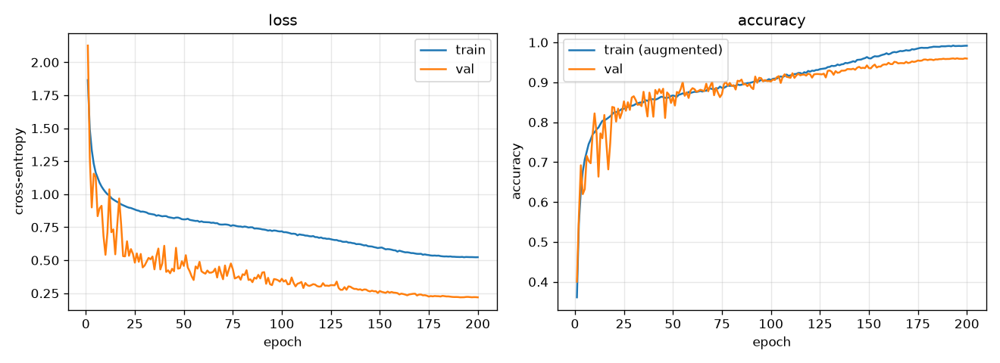

# ResNet under 5M parameters: Kaggle CIFAR-10 challenge

A CIFAR-style ResNet built for a Kaggle CIFAR-10 ResNet architecture challenge. The competition caps
models at **5M parameters**, and `train.py` refuses to train anything larger (`--max-params`, default
5,000,000). The training pipeline is a single PyTorch script that keeps the whole dataset on the GPU
and runs all augmentation there too, so a 100-epoch run takes about 5–6 minutes on one A100.

**Best result so far: Kaggle 0.854**, with 96.01% val and 96.07% local test accuracy (`runs/aug/cut_ls_e200`).

That run is a ResNet-20 with 3×3 kernels and width 64 (4.33M params), trained for 200 epochs with
Cutout and label smoothing:

```bash
python train.py --kernel 3 --blocks 3 3 3 --width 64 --cutout 16 --label-smoothing 0.1 \
    --epochs 200 --patience 0 --out runs/aug/cut_ls_e200
```

| Step | Kaggle |
|---|---|
| 5×5 baseline (2.99M params) | 0.811 |
| 3×3 kernels, wider (`wide3`, 4.33M params) | 0.825 |
| + Cutout 16, label smoothing 0.1, 200 epochs | **0.854** |

## Repository layout

```
train.py        model, data pipeline, augmentation, training loop, Kaggle submission writer
train.sbatch    SLURM job script (NYU HPC, A100, Singularity container)
runs/<name>/    output of each run: summary.json, history.json, curves.png, submission.csv
data/           competition data (not tracked, see below)
```

## Data

Download the competition files into `data/`:

| File | Contents |
|---|---|
| `train_images/`, `train_labels.csv` | 50,000 labeled 32×32 RGB PNGs, 5,000 per class (`id,filename,label`) |
| `test_images/`, `test.csv` | 2,000 unlabeled Kaggle test PNGs (`id,filename`) |
| `sample_submission.csv` | submission format (`id,label`) |

On first run the PNGs are decoded once into `data/cache.npz`. Later runs load that cache in seconds.

The labeled set is split **per class** with a fixed seed into:

| Split | Images | Role |
|---|---|---|
| train | 35,000 | gradient updates |
| val | 7,500 | picks the best epoch (checkpointing, early stopping) |
| test | 7,500 | scored **once** at the end, as an unbiased local estimate |

Every class has 750 images in val and 750 in test. The splits are set by `--val-frac` and
`--test-frac` (default 0.15 each). The runs in `runs/` outside `runs/aug/` used the earlier 0.1 / 0.1
split (40,000 / 5,000 / 5,000), so their numbers can't be compared directly with `runs/aug/`.

**Gap to Kaggle.** The 2,000 Kaggle test images are brighter and higher-contrast than the training
data:

| | Mean (R, G, B) | Std (R, G, B) |
|---|---|---|
| 50k labeled train | 0.491, 0.482, 0.447 | 0.247, 0.244, 0.262 |
| 2k Kaggle test | 0.513, 0.498, 0.461 | 0.265, 0.262, 0.275 |

This distribution shift explains why local accuracy runs about 10 points above the Kaggle score.
Augmentation and regularization narrow the gap: they gained about 1.5 points locally but 2.9 on Kaggle.

## Architecture

```
input 3×32×32
└─ stem: conv k×k(3→w) · BN · ReLU
   ├─ stage 1: n × BasicBlock(w),   32×32
   ├─ stage 2: n × BasicBlock(2w),  16×16   (first block stride 2)
   └─ stage 3: n × BasicBlock(4w),   8×8    (first block stride 2)
      └─ global average pool · linear(4w → 10)
```

Each `BasicBlock` is conv k×k · BN · ReLU · conv k×k · BN, plus a shortcut, then ReLU. The shortcut
is the identity, or a 1×1 conv + BN projection when the stride or channel count changes. Depth is
`2·sum(blocks) + 2`.

The number of stages (`--blocks`, one entry per stage), blocks per stage, base width (`--width`) and
kernel size (`--kernel`) are all flags. The script defaults to the original 5×5 baseline
(`--blocks 3 3 3 --width 32 --kernel 5`, 2,986,666 params). The current best design is
`--kernel 3 --blocks 3 3 3 --width 64` (4,327,754 params).

## Training recipe

| | |
|---|---|
| Optimizer | SGD, Nesterov momentum 0.9, lr 0.1, batch 128 |
| Weight decay | 5e-4 on conv/linear weights only (none on BN or biases) |
| Schedule | 1 epoch of linear warmup, then cosine decay to 0 |
| Normalization | per-channel mean/std computed on the training split |
| Precision | bfloat16 autocast, channels-last memory format |
| Epochs | 100 by default (`--epochs`), early stopping after 20 epochs without a new best val accuracy (`--patience`, 0 = off) |

All augmentation runs on the GPU, applied in this order:

| Flag | Augmentation | Default |
|---|---|---|
| `--jitter B C S` | color jitter on brightness, contrast, saturation | 0.2 0.2 0.2 |
| `--rotate D` | random rotation in ±D degrees, corners filled with the mean | off |
| (always on) | random horizontal flip, 4-px zero-pad random crop | on |
| `--cutout N` | blank one random N×N square | off |
| `--mixup A` | blend random image pairs and their labels, Beta(A, A) | off |
| `--label-smoothing E` | soften the cross-entropy targets | off |

The checkpoint with the best val accuracy is reloaded at the end to score the local test split and
write `submission.csv`.

## Results

All runs use seed 0. Each run's `summary.json` records its exact flags.

### Augmentation and regularization (`runs/aug/`, 35k / 7.5k / 7.5k split)

All runs use the `wide3` architecture (3×3, blocks 3 3 3, width 64) with color jitter 0.2. With 7,500
images, each accuracy has a standard error of about ±0.26 points, so treat differences under about
half a point as ties.

| Run | Rotate | Cutout | Label smoothing | Mixup | Epochs | Best val | Local test | Train acc* |
|---|---|---|---|---|---|---|---|---|
| `base` | | | | | 100 | 94.03% | 94.56% | 99.99% |
| `base_e200` | | | | | 200 | 94.79% | 94.77% | 99.99% |
| `rot` | 15° | | | | 100 | 93.83% | 93.97% | 99.78% |
| `cut_ls` | | 16 | 0.1 | | 100 | 95.43% | 95.73% | 98.35% |
| **`cut_ls_e200`** | | 16 | 0.1 | | 200 | **96.01%** | **96.07%** | 99.11% |
| `cut_ls_mix` | | 16 | 0.1 | 0.2 | 100 | 95.53% | 95.75% | 92.81% |
| `rot_cut_ls` | 15° | 16 | 0.1 | | 100 | 95.01% | 94.80% | 97.42% |
| `rot_cut_ls_e200` | 15° | 16 | 0.1 | | 200 | 95.29% | 95.49% | 98.55% |
| `all` | 15° | 16 | 0.1 | 0.2 | 100 | 94.99% | 95.05% | 92.15% |

\*Train accuracy at the best epoch, measured on augmented images (with mixup, against the dominant
label).

- **Cutout + label smoothing** is the clear win: about +1.3 points on val and test at 100 epochs. It
  also brings val and test into close agreement.
- **200 epochs** helps every configuration by about 0.3–0.7 points, and the gain stacks with Cutout +
  label smoothing.
- **Rotation hurts**, alone and combined, even at 200 epochs. At 32×32 it blurs the image and fills the
  corners, and CIFAR objects are almost always upright.
- **Mixup 0.2** is neutral at 100 epochs.

Training curves for `cut_ls_e200`:



### Architecture comparison under the 5M limit (40k / 5k / 5k split)

3×3 kernels, 100 epochs, color jitter 0.2, no other augmentation.

| Run | Blocks | Width | Depth | Params | Best epoch | Val acc | Local test acc | Train time |
|---|---|---|---|---|---|---|---|---|
| `wide3` | 3 3 3 | 64 | 20 | 4,327,754 | 99 | 94.40% | **94.68%** | 286 s |
| `deep3` | 4 4 4 | 56 | 26 | 4,501,570 | 90 | **94.98%** | 94.50% | 483 s |
| `r18` | 2 2 2 2 | 42 | 18 | 4,815,940 | 99 | 94.22% | 94.00% | 366 s |

`wide3` and `deep3` are tied within noise, and both beat the 5×5 baseline by about 1.8 points on local
test. `wide3` is the working choice because it trains fastest. A 4-stage ResNet-18-style layout
(`r18`) doesn't pay off at this budget.

### 5×5 baseline (40k / 5k / 5k split, blocks 3 3 3, width 32, 2.99M params)

| Run | Epochs | Color jitter | Best epoch | Val acc | Local test acc | Train time (A100) |
|---|---|---|---|---|---|---|
| `baseline_21361893` | 30 | off | 29 | 91.62% | 92.14% | 75 s |
| `baseline_21368912` | 100 | 0.2 / 0.2 / 0.2 | 90 | 93.44% | 92.74% | 390 s |
| `e100_jitter` | 100 | 0.2 / 0.2 / 0.2 | 90 | 93.44% | 92.74% | 381 s |
| `e100_nojitter` | 100 | off | 92 | 93.40% | 93.12% | 235 s |

`e100_jitter` repeats `baseline_21368912` and lands on identical numbers, so runs are reproducible.

## Usage

```bash
# quick CPU sanity check: 1 epoch on 1,000 images
python train.py --smoke

# current best recipe
python train.py --kernel 3 --blocks 3 3 3 --width 64 --cutout 16 --label-smoothing 0.1 \
    --epochs 200 --patience 0 --out runs/aug/cut_ls_e200
```

On the NYU HPC cluster, run from the parent `deep_learning/` directory:

```bash
sbatch kaggle_resnet_cifar10/train.sbatch
OUT=kaggle_resnet_cifar10/runs/aug/cut_ls_e200 \
ARGS="--kernel 3 --blocks 3 3 3 --width 64 --cutout 16 --label-smoothing 0.1 --epochs 200 --patience 0" \
    sbatch --export=ALL kaggle_resnet_cifar10/train.sbatch
```

Every run writes these files to `--out`:

- `submission.csv`: Kaggle predictions (`id,label`)
- `summary.json`: config, parameter count, best epoch, val and test accuracy, predicted class counts
- `history.json`: per-epoch train/val loss and accuracy, learning rate, epoch time
- `curves.png`: loss and accuracy plots
- `best.pt`: best checkpoint, with the normalization stats and args (not tracked in git)

Requirements: Python 3.12, PyTorch, NumPy, Pillow, and matplotlib.
