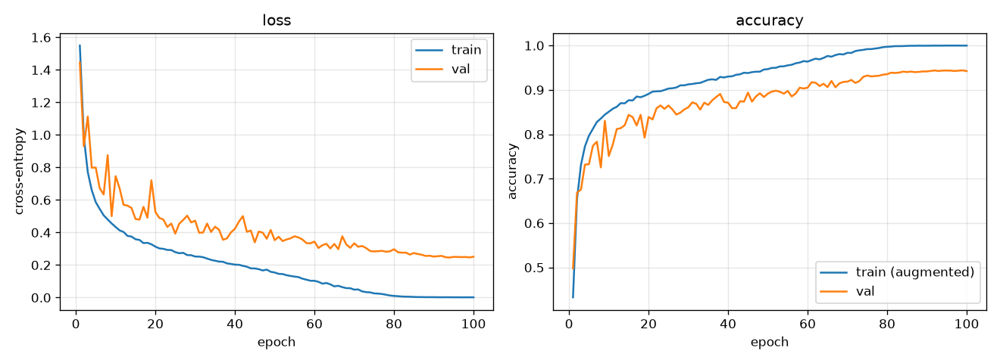

# ResNet with 5×5 convolutions: Kaggle CIFAR-10 challenge

A CIFAR-style ResNet that uses **5×5 kernels everywhere** (stem and all residual blocks), built for a
Kaggle CIFAR-10 ResNet architecture challenge. The training pipeline is a single PyTorch script that
keeps the whole dataset on the GPU and runs augmentation there too, so a 100-epoch run takes about
6.5 minutes on one A100.

The competition caps models at **5M parameters**. `train.py` refuses to train anything larger
(`--max-params`, default 5,000,000).

**Best result so far:** **94.68% held-out test accuracy** (94.40% val) with `runs/wide3`, a ResNet-20
with 3×3 kernels and width 64 (4.33M params). The Kaggle public score went from 0.811 to **0.825**
after switching to the 3×3 designs.

## Repository layout

```
train.py        model, data pipeline, training loop, Kaggle submission writer
train.sbatch    SLURM job script (NYU HPC, A100, Singularity container)
runs/<name>/    output of each run: summary.json, history.json, curves.png, submission.csv
data/           competition data (not tracked, see below)
```

## Data

Download the competition files into `data/`:

| File | Contents |
|---|---|
| `train_images/`, `train_labels.csv` | 50,000 labeled 32×32 RGB PNGs, 5,000 per class (`id,filename,label`) |
| `test_images/`, `test.csv` | 2,000 unlabeled Kaggle test PNGs (`id,filename`) |
| `sample_submission.csv` | submission format (`id,label`) |

On first run the PNGs are decoded once into `data/cache.npz`. Later runs load that cache in seconds.

The labeled set is split **per class** with a fixed seed into:

| Split | Images | Role |
|---|---|---|
| train | 40,000 | gradient updates |
| val | 5,000 | picks the best epoch (checkpointing, early stopping) |
| test | 5,000 | scored **once** at the end, as an unbiased local estimate of the Kaggle score |

## Architecture

```
input 3×32×32
└─ stem: conv5×5(3→w) · BN · ReLU
   ├─ stage 1: n × BasicBlock(w),   32×32
   ├─ stage 2: n × BasicBlock(2w),  16×16   (first block stride 2)
   └─ stage 3: n × BasicBlock(4w),   8×8    (first block stride 2)
      └─ global average pool · linear(4w → 10)
```

Each `BasicBlock` is conv5×5 · BN · ReLU · conv5×5 · BN, plus a shortcut, then ReLU. The shortcut is
the identity, or a 1×1 conv + BN projection when the stride or channel count changes. Depth is
`2·sum(blocks) + 2`.

The script's default config, `--blocks 3 3 3 --width 32 --kernel 5`, gives ResNet-20 with 2,986,666
parameters. The number of stages, blocks per stage, base width and kernel size are all flags, and a
fourth entry in `--blocks` adds a fourth stage. The current best design is
`--kernel 3 --blocks 3 3 3 --width 64` (4,327,754 parameters).

## Training recipe

| | |
|---|---|
| Optimizer | SGD, Nesterov momentum 0.9, lr 0.1, batch 128 |
| Weight decay | 5e-4 on conv/linear weights only (none on BN or biases) |
| Schedule | 1 epoch of linear warmup, then cosine decay to 0 |
| Augmentation (GPU) | color jitter (brightness/contrast/saturation ±0.2), random horizontal flip, 4-px zero-pad random crop |
| Normalization | per-channel mean/std computed on the training split |
| Precision | bfloat16 autocast, channels-last memory format |
| Epochs | 100, early stopping after 20 epochs without a new best val accuracy |

The checkpoint with the best val accuracy is reloaded at the end to score the local test split and
write `submission.csv`.

## Results

All runs use the training recipe above with seed 0. The local test split is the number to compare
across runs. With 5,000 images, each accuracy has a standard error of about ±0.3 points.

**5×5 baseline (blocks 3 3 3, width 32, 2.99M params)**

| Run | Epochs | Color jitter | Best epoch | Val acc | Local test acc | Train time (A100) |
|---|---|---|---|---|---|---|
| `baseline_21361893` | 30 | off | 29 | 91.62% | 92.14% | 75 s |
| `baseline_21368912` | 100 | 0.2 / 0.2 / 0.2 | 90 | 93.44% | 92.74% | 390 s |
| `e100_jitter` | 100 | 0.2 / 0.2 / 0.2 | 90 | 93.44% | 92.74% | 381 s |
| `e100_nojitter` | 100 | off | 92 | 93.40% | 93.12% | 235 s |

`e100_jitter` repeats `baseline_21368912` and lands on identical numbers, so runs are reproducible.
Color jitter doesn't help on the local split.

**Architecture comparison under the 5M limit (3×3 kernels, 100 epochs, color jitter 0.2)**

| Run | Blocks | Width | Depth | Params | Best epoch | Val acc | Local test acc | Train time |
|---|---|---|---|---|---|---|---|---|
| `wide3` | 3 3 3 | 64 | 20 | 4,327,754 | 99 | 94.40% | **94.68%** | 286 s |
| `deep3` | 4 4 4 | 56 | 26 | 4,501,570 | 90 | **94.98%** | 94.50% | 483 s |
| `r18` | 2 2 2 2 | 42 | 18 | 4,815,940 | 99 | 94.22% | 94.00% | 366 s |

`wide3` and `deep3` are tied within noise, and both beat the 5×5 baseline by about 1.8 points on
local test. `wide3` is the working choice because it trains fastest. A 4-stage ResNet-18-style
layout (`r18`) doesn't pay off at this budget.

Training curves for `wide3`:



**Gap to Kaggle.** The 2,000 Kaggle test images are brighter and higher-contrast than the training
data:

| | Mean (R, G, B) | Std (R, G, B) |
|---|---|---|
| 50k labeled train | 0.491, 0.482, 0.447 | 0.247, 0.244, 0.262 |
| 2k Kaggle test | 0.513, 0.498, 0.461 | 0.265, 0.262, 0.275 |

This distribution shift, not the split, explains why about 94.7% locally becomes 0.825 on Kaggle.
The local splits are exactly balanced (500 per class in val and test) and share no images. Every model
also fits its training data almost perfectly (99.9%+ train accuracy). Data augmentation and other
regularization aimed at the shift are the next focus.

## Usage

```bash
# full run: 100 epochs with early stopping, writes runs/baseline/
python train.py

# quick CPU sanity check: 1 epoch on 1,000 images
python train.py --smoke

# current best design
python train.py --kernel 3 --blocks 3 3 3 --width 64 --out runs/wide3

# other variants
python train.py --blocks 2 2 2 --width 16
python train.py --epochs 200 --patience 0 --jitter 0 0 0 --out runs/e200
```

On the NYU HPC cluster (run from the parent `deep_learning/` directory):

```bash
sbatch kaggle_resnet_cifar10/train.sbatch
OUT=kaggle_resnet_cifar10/runs/e200 ARGS="--epochs 200 --patience 0" sbatch --export=ALL kaggle_resnet_cifar10/train.sbatch
```

Every run writes these files to `--out`:

- `submission.csv`: Kaggle predictions (`id,label`)
- `summary.json`: config, parameter count, best epoch, val and test accuracy, predicted class counts
- `history.json`: per-epoch train/val loss and accuracy, learning rate, epoch time
- `curves.png`: loss and accuracy plots
- `best.pt`: best checkpoint, with the normalization stats and args (not tracked in git)

Requirements: Python 3.12, PyTorch, NumPy, Pillow, and matplotlib.
